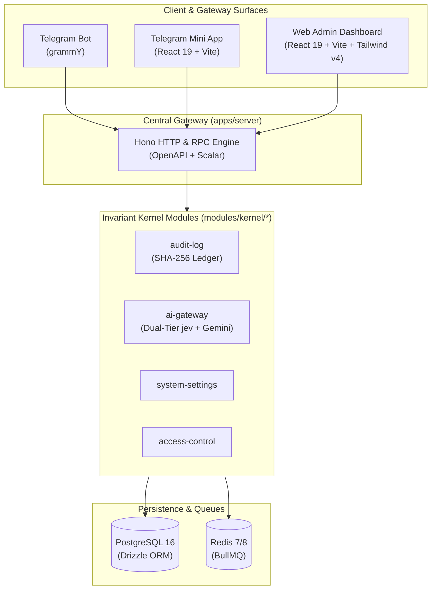

# Tembot-v2 Platform

> **Sovereign, Domain-Agnostic Omnichannel Modular Monolith Template & Starter Kit**  
> Unifying Telegram Bot (`grammY`), Telegram Mini App (`React 19`), and Web Admin Dashboard (`React 19`) over a central Hono HTTP & RPC Gateway.

[](https://github.com/SalehOsman/Tempot/actions/workflows/ci.yml)
[](LICENSE)
[](https://nodejs.org/)
[](https://pnpm.io/)
[](https://www.typescriptlang.org/)
[](https://biomejs.dev/)

---

## 1. Architecture Overview

Tembot-v2 unifies three sovereign user surfaces into a single high-performance TypeScript monorepo powered by **Turborepo** and **pnpm**:



---

## 2. Monorepo Structure

```
tembot-v2/
├── .github/workflows/          # CI/CD automation (lint, typecheck, tests)
├── apps/                       # Entrypoint applications (server, bot, tma, dashboard)
├── modules/
│   ├── kernel/                 # Invariant platform capabilities
│   │   ├── audit-log/          # Cryptographic SHA-256 tamper-evident ledger
│   │   └── ai-gateway/         # Dual-tier AI: TypeSafe AI jev + Gemini/DeepSeek
│   └── domain/                 # Pluggable business modules (e.g. loyalty, catalog)
├── packages/                   # Core shared libraries
│   ├── ai-core/                # ApiKeyRotator & TypeSafe AI JevClient
│   ├── contracts/              # Browser-safe Zod DTO contracts
│   ├── core-components/        # Telegram Rich Messages & viewport budget checks
│   ├── db-kernel/              # Drizzle base columns & Outbox table
│   ├── kernel-registry/        # Dynamic module registry & DAG cycle validator
│   ├── logger/                 # Pino structured logger with automated PII masking
│   ├── shared-types/           # Result (neverthrow), DomainError & ProblemDetails
│   ├── slice-toolkit/          # defineAction builder & Outbox event factory
│   ├── test-toolkit/           # Pinned TestClock & mock actor factories
│   └── ui/                     # Shared React 19 UI component library
├── tooling/
│   └── plop/                   # Scaffolding CLI templates
└── docs/                       # Canonical architecture documentation
```

---

## 3. Quick Start

### Prerequisites
- Node.js $\ge 22.0.0$
- pnpm $\ge 10.5.2$
- Docker & Docker Compose (for PostgreSQL 16 & Redis 7)

### Installation
```bash
# Clone the repository
git clone https://github.com/SalehOsman/Tempot.git
cd Tempot

# Install workspace dependencies
pnpm install

# Run the test suite
pnpm test

# Run code quality & linter checks
pnpm check:biome

# Run monorepo typecheck
pnpm typecheck
```

---

## 4. Code Generation CLI

Generate new architectural components pre-wired for logging, validation, and audit:

```bash
# Scaffold a new module (domain or kernel)
pnpm module:create

# Scaffold a new vertical slice inside a module
pnpm slice:create
```

---

## 5. Verification & Quality Gates

The codebase strictly enforces the **10 Engineering Taboos** through automated quality gates:

| Gate | Tool | Command |
| :--- | :--- | :--- |
| **Lint & Format** | Biome | `pnpm check:biome` |
| **Type Integrity** | TypeScript / Turbo | `pnpm typecheck` |
| **Unit & Contract Tests** | Vitest | `pnpm test` |
| **Database Migrations** | Drizzle Kit | `pnpm db:generate` |

---

## 6. License

This repository is licensed under the MIT License. See [LICENSE](LICENSE) for details.
