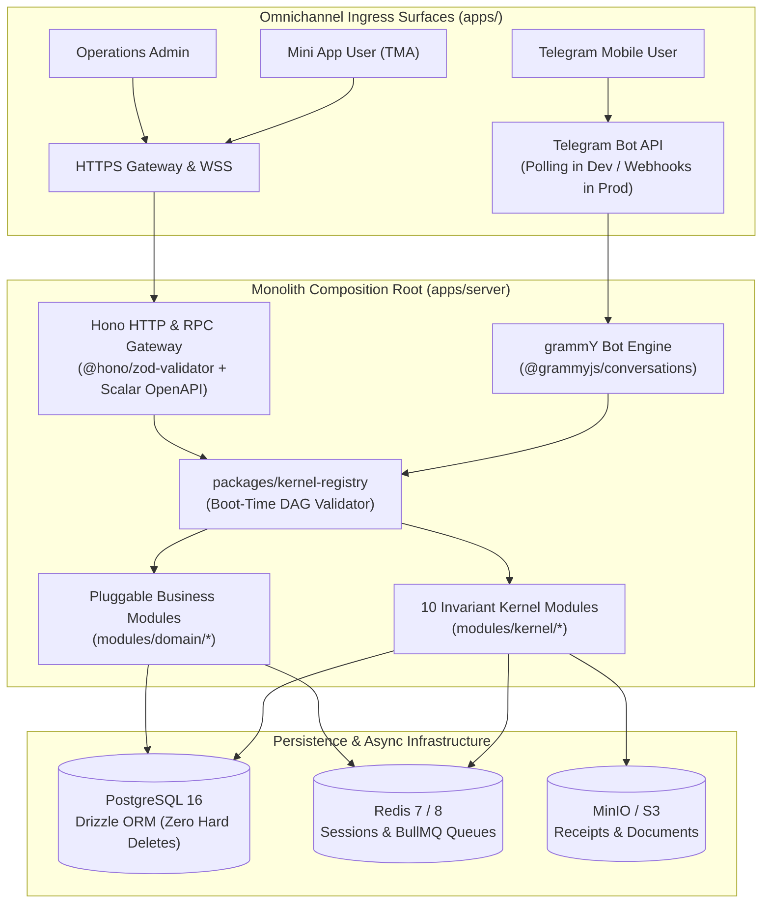

# System Overview & Domain-Agnostic Starter Philosophy

## 1. Executive Vision
The **Tembot-v2 Platform** is an enterprise-grade, **domain-agnostic omnichannel business automation engine and starter kit**. Rather than being bound to a single vertical (such as a generic store or restaurant), it serves as a hardened, extensible modular monolith foundation.

Developers and organizations can adopt this template to power operations across any business domain:
- **E-Commerce & Digital Catalogs**
- **Clinic & Appointment Scheduling**
- **Ticketing & Event Booking**
- **Customer Support & Service Desks**
- **Logistics & Delivery Dispatching**

The platform guarantees zero divergence across three core client surfaces:
1. **Telegram Bot Client (`apps/bot`):** Conversational wizards driven by `grammY` adhering to strict mobile viewport layout budgets and rich message templates.
2. **Telegram Mini App (`apps/tma`):** High-fidelity mobile web experience embedded inside Telegram, built with `React 19` and `@telegram-apps/sdk-react`.
3. **Web Admin Dashboard (`apps/dashboard`):** Central operations, configuration, queue management (Bull-Board), and audit portal built with `React 19`, `TanStack Table`, and `TanStack Query`.

All client surfaces communicate with a centralized **Hono HTTP & RPC Gateway (`apps/server`)** ensuring compile-time type safety (`hc<AppType>`) and single-source-of-truth validation.

---

## 2. High-Level C4 Context Diagram

---

## 3. Core Architectural Invariants

1. **Controller Purity:** Ingress controllers (Hono routes, grammY listeners) never execute direct database queries or domain calculations; they strictly parse contracts and delegate to internal application ports.
2. **Zero Hard Deletes:** Production data records are logically tombstoned (`deleted_at` timestamp), permanently prohibiting destructive `DELETE FROM` SQL executions.
3. **Arbitrary-Precision Financial Math:** All monetary quantities are computed using arbitrary-precision decimal mathematics (`decimal.js`), permanently prohibiting IEEE-754 floating-point numbers (`number`).
4. **Deterministic Temporal Pinning:** Domain operations and tests inject clock providers (`SystemClock` or pinned test anchors) rather than consuming non-deterministic system clocks.
5. **Typed Result Architecture:** All fallible operations return typed `Result<T, DomainError>` via `neverthrow`. Swallowing errors or fabricating fallback nulls is strictly prohibited.
6. **Multi-Tenancy Readiness:** Database schemas and actor identities support an optional `tenant_id`, enabling single-tenant or SaaS multi-tenant topologies without database refactoring.
