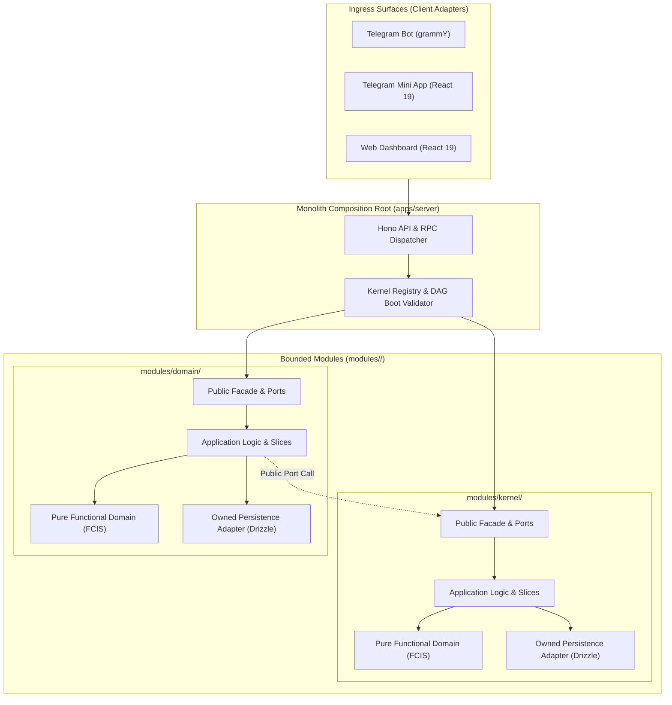

# Modular Monolith Architecture & Module Standards

## 1. Architectural Philosophy

The **Tembot-v2 Platform** is architected as an enterprise-grade **Modular Monolith** operating under a single composition root and deployment boundary. It unites multiple ingress surfaces on top of an invariant-enforcing domain core.

---

## 2. The 3-Tier Structural Hierarchy

1. **Tier 1: Category Scope (`modules/`):**
   - **`kernel/`:** Platform infrastructure, security, observability, and core bot configuration (The 10 Invariant Modules).
   - **`domain/`:** Pluggable, business-specific operational modules (e.g., store, booking, ticketing).
2. **Tier 2: Bounded Modules (`modules/<category>/<module>/`):**
   - Strict ownership boundary owning its database tables, migrations, domain core, and public barrel (`index.ts`).
   - Grouping metadata (`context?: string` in `module.manifest.ts`) clusters modules logically without filesystem nesting.
3. **Tier 3: Vertical Slices (`slices/<use-case>/`):**
   - Self-contained vertical slices implementing discrete business use cases.

---

## 3. Normative Architecture Rules (ARCH-01 through ARCH-10)

- **ARCH-01 (Single Composition Root):** Backend runs under one composition root. Modules declare dependencies explicitly in `module.manifest.ts`. Dynamic runtime file scanning is strictly prohibited.
- **ARCH-02 (Layer Direction & FCIS Purity):** Pure domain logic must not import HTTP libraries, Telegram SDKs, React, or database drivers. Infrastructure implements ports wired at the composition boundary.
- **ARCH-03 (Public Barrel Encapsulation):** Cross-module access occurs exclusively through approved exports in `index.ts`. Direct deep imports into another module's `slices/` or `db/` are mechanically blocked.
- **ARCH-04 (Acyclic Dependency Graph):** The composition root validates that module dependencies form a strict Directed Acyclic Graph (DAG) during boot.
- **ARCH-05 (Strict Data Ownership):** Every database table is owned by exactly one module. Cross-module database joins or direct raw SQL queries into another module's tables are forbidden.
- **ARCH-06 (Typed Results via Neverthrow):** Domain, application, and repository operations return `Result<T, DomainError>`. Raw unchecked exceptions are prohibited.
- **ARCH-07 (Reliable Outbox Side Effects):** State mutations requiring asynchronous events must atomically insert an outbox record within the same database transaction.
- **ARCH-08 (Static Restart Lifecycle):** Adding or removing modules requires recompilation and application restart. Hot-reloading uncompiled modules in production is prohibited.
- **ARCH-09 (Surface Invariance):** Telegram Bot, TMA, and Dashboard adapters invoke the exact same underlying application ports for identical business actions.
- **ARCH-10 (Acceptance & Test Parity):** Every use case maps to executable positive and negative unit/integration tests with deterministic time anchors.
