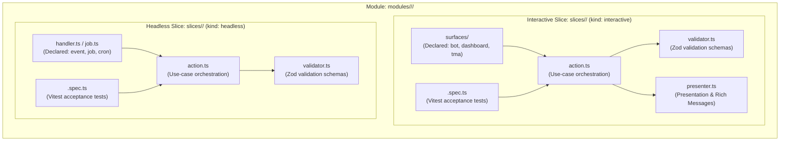

# Vertical Slice Architecture Methodology

## 1. Core Architectural Principle: Encapsulation over Layering

Rather than partitioning the codebase horizontally across traditional layers (`controllers/`, `services/`, `repositories/`), the Tembot-v2 Platform organizes business capabilities into **Vertical Slices** hosted within bounded modules:

```text
modules/<category>/<module>/slices/<use-case>/
```



---

## 2. Capability-Driven Slice Profiles

Vertical slices are defined by declared capability profiles in `module.manifest.ts`:

```typescript
export type SliceKind = 'interactive' | 'headless';

export type SliceEntrypoint =
  | 'bot'
  | 'dashboard'
  | 'tma'
  | 'http'
  | 'event'
  | 'job'
  | 'cron'
  | 'internal';

export interface SliceDescriptor {
  readonly sliceId: string;
  readonly kind: SliceKind;
  readonly entrypoints: readonly SliceEntrypoint[];
}
```

### 2.1 Interactive Slices (`kind: "interactive"`)
Interactive slices handle direct human interactions across client surfaces (`bot`, `dashboard`, `tma`):
```text
slices/<use-case>/
├── action.ts                 # Primary use-case entry point invoking application ports
├── validator.ts              # Zod input/output validation schemas
├── presenter.ts              # Presentation formatting and Rich Message template binding
├── surfaces/                 # Surface adapters (strictly matching declared entry points)
│   ├── bot.ts                # grammY conversation step or command handler
│   ├── dashboard.tsx         # React 19 dashboard view
│   └── tma.tsx               # Telegram Mini App view
└── <use-case>.spec.ts        # Isolated slice acceptance tests (Vitest)
```

### 2.2 Headless Slices (`kind: "headless"`)
Headless slices execute background, event-driven, or scheduled domain workflows (`http`, `event`, `job`, `cron`, `internal`):
```text
slices/<use-case>/
├── action.ts                 # Primary use-case orchestration
├── validator.ts              # Zod validation schemas
├── handler.ts / job.ts       # Queue consumer, event handler, or HTTP handler
└── <use-case>.spec.ts        # Unit and integration acceptance tests
```

---

## 3. Slice Component Invariants

1. **`action.ts` (Orchestration):**
   - Coordinates domain models and application ports.
   - Accepts validated DTOs, returns `Result<T, DomainError>`.
   - Free from direct HTTP or Telegram dependencies.
2. **`validator.ts` (Contracts):**
   - Zod schemas for input payloads, query parameters, and output contracts.
   - Enforces runtime typing and structural validation before execution.
3. **`presenter.ts` (Surface Formatting):**
   - Formats domain output into transport-agnostic view models or Rich Message templates.
   - Handles text interpolation, localization (Arabic RTL / English), and mobile viewport limits.
4. **`<use-case>.spec.ts` (Acceptance Tests):**
   - Tests execute against `action.ts` using in-memory port stubs or ephemeral Testcontainers.
   - Verifies positive path, permission denial, invalid input, and edge cases.
