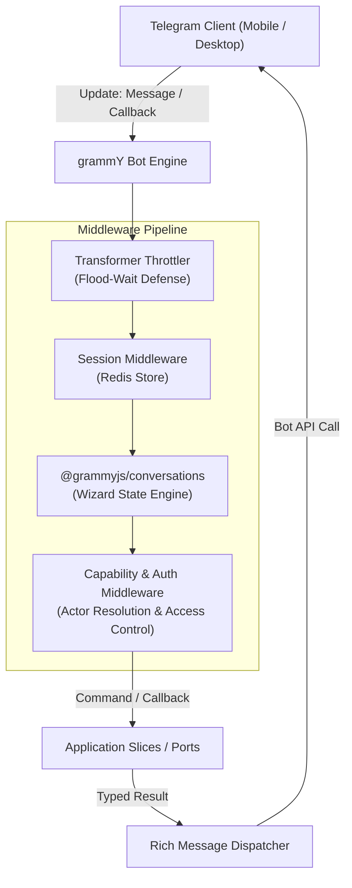

# Telegram Bot Client Specification (`apps/bot`)

## 1. Executive Summary & Stack
The **Tembot-v2 Telegram Bot** powers conversational ingress across customer and operator interactions:
- **Bot Engine:** grammY (`grammy@1.46.0`)
- **Conversation State Engine:** `@grammyjs/conversations@2.1.1`
- **Flood Protection & Throttling:** `@grammyjs/transformer-throttler@1.2.1`
- **Component & Template Library:** `@tembot/core-components`

---

## 2. Interaction Architecture

---

## 3. Standard Root Commands

- `/start`: Initializes user profile and renders the RTL interactive welcome card.
- `/menu`: Displays the main service navigation menu.
- `/app`: Direct launcher for the Telegram Mini App (TMA).
- `/settings`: Tri-surface configuration (language preference, notifications).
- `/help`: Contextual support manual and contact details.
- `/cancel`: Gracefully aborts any active multi-step conversation wizard and clears session state.

---

## 4. Execution Modes

1. **Local Development (Polling Mode):**
   * Uses `@grammyjs/runner` with `sequentialize` middleware.
   * Runs locally without requiring public domain or SSL certificates.
2. **Production Deployment (Webhook Mode):**
   * Hosted on Hono HTTP gateway (`POST /api/v1/telegram/webhook`).
   * Validates `X-Telegram-Bot-Api-Secret-Token` on every inbound update.
