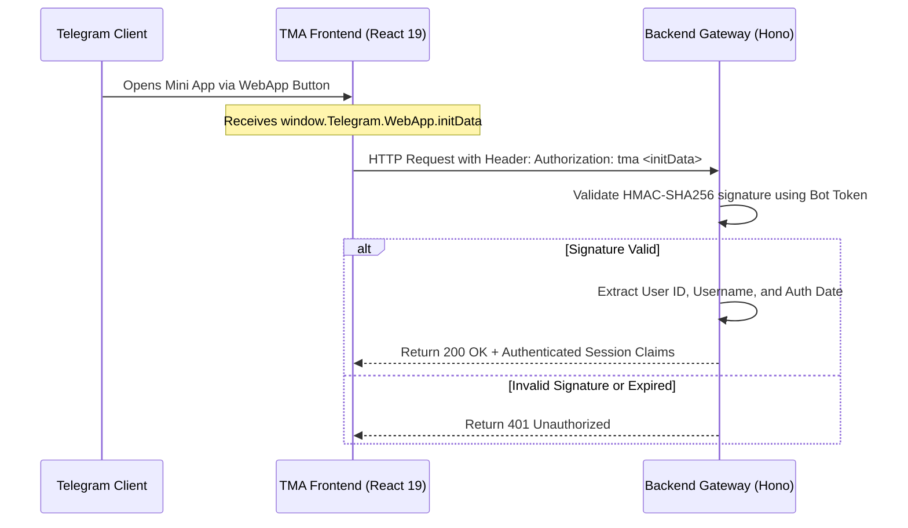

# Telegram Mini App (TMA) Specification (`apps/tma`)

## 1. Executive Summary & Stack
The **Tembot-v2 Telegram Mini App (TMA)** provides an interactive, full-fidelity web interface embedded directly inside the Telegram client (iOS, Android, and Desktop):
- **Framework:** React 19 (`react@19.3.0`)
- **Build Tool:** Vite (`vite@8.3.1`)
- **Telegram Bridge:** `@telegram-apps/sdk-react@3.3.9`
- **Server Validation:** `@telegram-apps/init-data-node@1.0.4`
- **State & Data Fetching:** TanStack Query (`@tanstack/react-query@5.67.2`)
- **Styling & Components:** Tailwind CSS (`tailwindcss@4.3.3`) + `@tembot/ui` (shadcn/ui)

---

## 2. Authentication & Cryptographic Handshake (`initData`)

The Mini App never trusts raw client-side identity data (`initDataUnsafe`). All server communication relies on cryptographic verification of `initData`.

---

## 3. UI/UX & Native Telegram Integration

1. **Theme Synchronization:**
   * Automatically synchronizes `themeParams` (background, text color, secondary background).
   * Switches seamlessly between Light and Dark mode without page reload.
2. **Native Controls Lifecycle:**
   * **MainButton:** Primary action button pinned at the bottom of the native Telegram window.
   * **BackButton:** Native top-bar back button integrated with React Router.
   * **HapticFeedback:** Haptic vibrations triggered on interactive clicks, selections, and error notifications.
3. **Viewport Discipline:**
   * Calls `expand()` on launch to utilize full viewport height.
   * Prevents accidental vertical pull-to-refresh bounce.
4. **Bi-Directional Language Support (RTL/LTR):**
   * Built-in Right-to-Left (RTL) styling for Arabic users via Tailwind RTL utilities.
