# Web Admin Dashboard Specification (`apps/dashboard`)

## 1. Executive Summary & Stack
The **Tembot-v2 Web Admin Dashboard** is the operations, configuration, and monitoring portal for operators and auditors:
- **Framework:** React 19 (`react@19.3.0`)
- **Build Tool:** Vite (`vite@8.3.1`)
- **Data Tables:** TanStack Table (`@tanstack/react-table@8.21.2`)
- **Remote State:** TanStack Query (`@tanstack/react-query@5.67.2`)
- **Transport & Types:** Hono RPC Client (`hc<AppType>`) consuming `@tembot/contracts`
- **UI Components & Layout:** Tailwind CSS (`tailwindcss@4.3.3`) + `@tembot/ui` (shadcn/ui + Lucide Icons)
- **Visual Design Reference:** Modeled after [Studio Admin Dashboard](https://github.com/arhamkhnz/next-shadcn-admin-dashboard) (clean card-based telemetry, collapsible sidebar, dark/light theme) adapted to Vite + React 19
- **Queue Monitor:** Embedded Bull-Board (`@bull-board/hono`) for visual BullMQ queue tracking
- **API Documentation:** Interactive Scalar OpenAPI (`@scalar/hono-api-reference`)
- **Live Stream:** Server-Sent Events (SSE) for real-time audit logs and queue statistics without polling

---

## 2. Layout & Information Architecture

```mermaid
flowchart TD
    subgraph DashboardLayout ["Web Admin Dashboard (React 19)"]
        Sidebar["Navigation Sidebar\n(Collapsible, Responsive)"]
        TopNav["Top Navigation Bar\n(Active Profile, Surface Switcher, Theme Toggle)"]
        ContentArea["Dynamic Content Viewport\n(TanStack Query + TanStack Table)"]
    end

    Sidebar --> S1["1. Overview & System Health"]
    Sidebar --> S2["2. System Settings (Branding, Maintenance Mode)"]
    Sidebar --> S3["3. Access Control (Actors, Dynamic Roles, Capabilities)"]
    Sidebar --> S4["4. Audit Log & Incident Stream (Live SSE)"]
    Sidebar --> S5["5. Performance & Telemetry (Latency, CPU, RAM)"]
    Sidebar --> S6["6. Broadcast Engine (Campaigns, Throttling Stats)"]
    Sidebar --> S7["7. Backup Vault (Snapshots, Disaster Recovery)"]
    Sidebar --> S8["8. Task Scheduler (Bull-Board Queue Monitor)"]
    Sidebar --> S9["9. External Integrations (Google Services Vault)"]
    Sidebar --> S10["10. Interactive API Docs (Scalar OpenAPI)"]

    TopNav --> ContentArea
    Sidebar --> ContentArea
```

---

## 3. Core Functional Views

### 3.1 Capability & Role Management
- **Zero-Role Engine:** Administrators assign fine-grained capabilities (`settings:read`, `broadcast:publish`, `orders:create`) to dynamic roles.
- **Auto-Discovery:** Pluggable domain modules expose capabilities in their manifest; the dashboard auto-discovers and exposes them as selectable toggles.

### 3.2 Real-Time Observability & Queue Control
- **Bull-Board:** Embedded visual inspector for BullMQ background queues. Operators can inspect active, delayed, and failed jobs, and trigger instant retries.
- **Live SSE Event Stream:** Real-time push stream of audit logs, errors, and system state transitions without polling.

### 3.3 Zero-Leakage Typed Transport (`@tembot/contracts`)
The dashboard imports API routes and DTO contracts strictly from `@tembot/contracts`. It contains zero dependencies on Node.js, database drivers, or backend runtime code, ensuring clean, lightweight client-side Vite builds.
