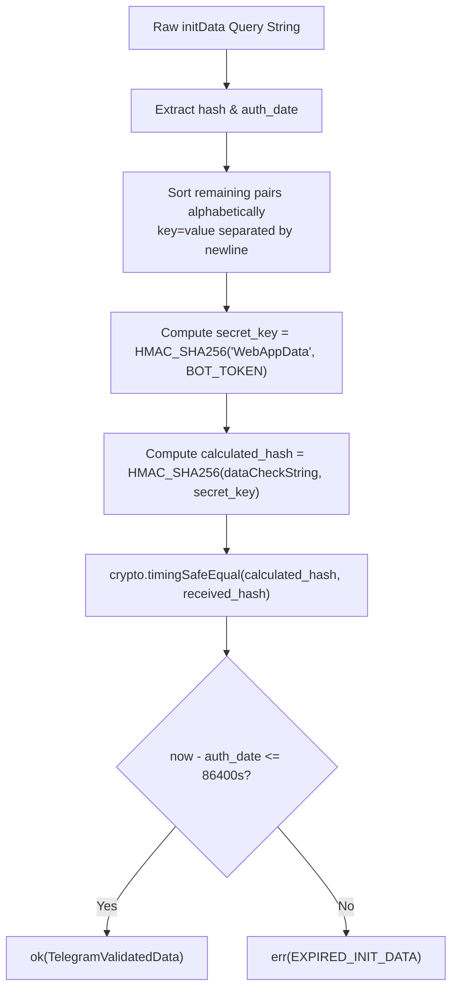

# Kernel Module: Access Control & Governance (`access-control`)

> **Architectural Paradigm:** Sovereign Zero-Role Capability Engine, Cryptographic HMAC-SHA256 Auth, & Session Management  
> **Package:** `@tembot/module-access-control` (`modules/kernel/access-control`)  
> **Interactive Surface:** TMA Cryptographic Ingress + Web Admin Dashboard Session Lifecycle  
> **Exposed Capabilities:** `auth:authenticate`, `auth:revoke`, `access:manage`, `operator:manage`  

---

## 1. Architectural Responsibility

The `access-control` module is the platform's cryptographic security and capability boundary authority:
1. **Cryptographic Telegram `initData` Verification:** Uses HMAC-SHA256 with timing-safe comparison (`crypto.timingSafeEqual`) to prevent Telegram user impersonation or spoofing.
2. **Replay Attack Immunity:** Enforces a maximum signature age of 24 hours ($\le 86,400$s) based on `auth_date`.
3. **Operator Session Lifecycle:** Generates and tracks cryptographically hashed session tokens (SHA-256) with instant revocation capabilities and scrypt password hashing.
4. **Dynamic Capability Engine (`ctx.can`):** Eliminates hardcoded role checks in code (`if (user.role === 'admin')`). Code evaluates fine-grained atomic capabilities (`settings:write`, `audit:read`) with wildcard expansion (`*` and `domain:*`).

---

## 2. Telegram `initData` Cryptographic Algorithm

---

## 3. Schema & Data Invariants

- **Tables:**
  - `operators`: Administrative actors with scrypt-hashed credentials and soft-delete lifecycle.
  - `operator_sessions`: Cryptographic SHA-256 session tokens with expiration and instant revocation (`revoked_at`).
  - `role_profiles`: Dynamic capability groupings assigned to operators without code modifications.
- **Invariants Enforced:**
  - Taboo 2: Zero Hard Deletes (`deleted_at` timestamptz).
  - Taboo 4: Deterministic audit timestamps (`created_at`, `updated_at`, `revoked_at`).
  - Taboo 5: Typed `neverthrow` results (`Result<T, AccessError>`).
  - Taboo 7: Multi-tenancy isolation (`tenant_id`).
