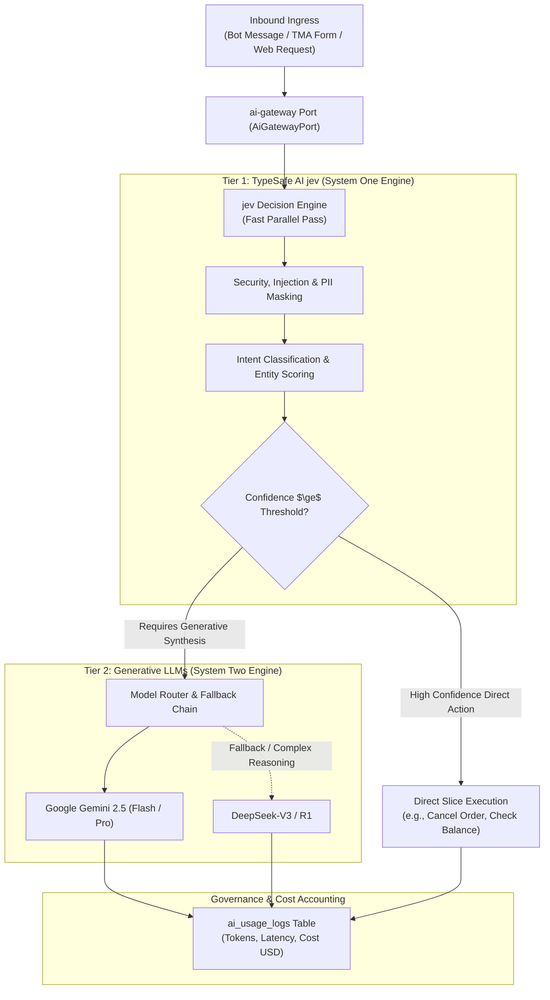

# Kernel Module: AI Gateway (`ai-gateway`)

> **Architectural Paradigm:** Dual-Tier System One + System Two Cognitive Engine  
> **System One Engine:** TypeSafe AI `jev` (Deterministic Probabilistic Decision Engine)  
> **System Two Engine:** Generative LLMs (Google Gemini 2.5 Flash/Pro, DeepSeek-V3 / R1)  
> **Authority & Registry:** `modules/kernel/ai-gateway`

---

## 1. Architectural Responsibility

The `ai-gateway` module provides an enterprise-grade, omnichannel AI control plane uniting:
1. **System One Decision-Making (TypeSafe AI `jev`):**
   * Sub-millisecond, deterministic evaluations over structured JSON state.
   * Single-pass probability scoring, intent classification, and safety/PII triage.
   * Confidence threshold gating (execute automatically if confidence $> 90\%$, route to generative model or human escalation if lower).
2. **System Two Generative Synthesis (Gemini & DeepSeek):**
   * Contextual multi-turn conversational replies in the Telegram Bot and TMA.
   * Content summarization, language translation, and complex business drafting.
3. **Cost, Quota & Token Accounting:**
   * Tracking per-user, per-slice, and per-tenant token usage and financial cost in PostgreSQL.
   * Web Admin Dashboard views for live model latency, fallback events, and spend analytics.

---

## 2. Dual-Engine Interaction Workflow



---

## 3. Public Ports & Capabilities

```typescript
export interface AiGatewayPort {
  /**
   * System One: Fast deterministic decision evaluation via TypeSafe AI jev.
   */
  evaluateDecision<TSchema>(
    state: Record<string, unknown> | string,
    schema: TSchema,
  ): Promise<Result<JevDecisionResult<TSchema>, AiGatewayError>>;

  /**
   * System Two: Generative response synthesis with automatic fallback.
   */
  generateResponse(
    request: AiGenerationRequest,
  ): Promise<Result<AiGenerationResponse, AiGatewayError>>;
}
```

Exposed Capabilities:
- `ai:evaluate`: Run System One decision scoring via `jev`.
- `ai:generate`: Run generative LLM workflows via Gemini/DeepSeek.
- `ai:manage`: Configure model keys, fallback chains, and view usage metrics in the Admin Dashboard.
