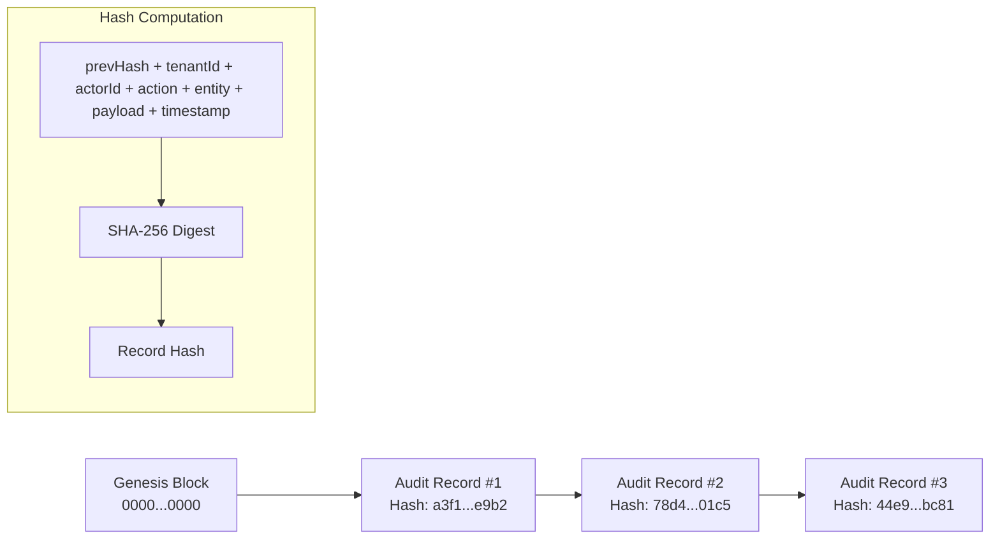

# Kernel Module: Audit Log (`audit-log`)

> **Architectural Paradigm:** Append-Only Cryptographic Forensic Ledger  
> **Integrity Verification:** SHA-256 Hash Chaining (Blockchain-Style Tamper Evidence)  
> **Authority & Package:** `@tembot/module-audit-log` (`modules/kernel/audit-log`)  

---

## 1. Architectural Responsibility

The `audit-log` kernel module enforces immutable forensic record-keeping across all user, operator, and system actions.

Key guarantees:
1. **Append-Only Invariant:** Audit records can never be updated or soft-deleted. There is no `updated_at` or `deleted_at` column.
2. **SHA-256 Hash Chaining:** Every log entry links to the cryptographic signature of the preceding log entry. Any in-database tampering immediately breaks chain validation.
3. **Forensic Error Capturing:** The `ErrorRecorder` component extracts full diagnostic metadata, stack traces, and RFC 7807 problem details while sanitizing sensitive credentials via `@tembot/logger`.

---

## 2. Cryptographic Hash Chain Workflow



---

## 3. Public API & Usage

```typescript
import { AuditService, ErrorRecorder } from '@tembot/module-audit-log';

// 1. Record an event
const recordResult = await auditService.record({
  tenantId: 'uuid',
  actorId: 'admin_123',
  actorType: 'admin',
  action: 'system.maintenance_mode_toggled',
  entityType: 'system_setting',
  payload: { enabled: true },
});

// 2. Capture an error with forensic diagnostics
const errorResult = await errorRecorder.captureError({
  tenantId: 'uuid',
  action: 'ai.generate_response',
  error: caughtException,
});

// 3. Verify ledger continuity
const integrityReport = await auditService.verifyChain(tenantId);
if (!integrityReport.value.isValid) {
  console.error(`Tampering detected at: ${integrityReport.value.corruptedRecordId}`);
}
```
