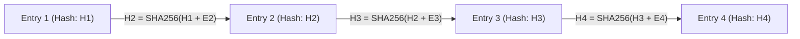

# Financial Ledger Invariants & Cryptographic Audit Proofs

## 1. Mathematical Double-Entry Invariant

Every financial movement is modeled as an atomic transaction $T$ composed of $n$ entries ($n \ge 2$), satisfying:

$$\sum_{i=1}^{n} D_i - \sum_{j=1}^{m} C_j = 0$$

Where $D_i$ represents debit amounts and $C_j$ represents credit amounts, computed using arbitrary-precision arithmetic (`decimal.js@10.6.0`). Any transaction failing this mathematical proof is rejected by domain validation and database triggers.

---

## 2. Cryptographic Audit Chain & Non-Repudiation

To guarantee non-repudiation and prevent historical modification of financial records:



1. **Hash Chaining:** Each ledger transaction record contains a `previous_hash` column referencing the hash of the preceding entry in the organization's journal.
2. **Immutable Tables:** PostgreSQL trigger rules block `UPDATE` and `DELETE` commands on `ledger_entries` and `audit_logs`:
   ```sql
   CREATE OR REPLACE FUNCTION prevent_modification()
   RETURNS TRIGGER AS $$
   BEGIN
       RAISE EXCEPTION 'Cryptographic immutability violation: Mutations on % are prohibited.', TG_TABLE_NAME;
   END;
   $$ LANGUAGE plpgsql;

   CREATE TRIGGER trg_immutable_ledger
   BEFORE UPDATE OR DELETE ON ledger_entries
   FOR EACH ROW EXECUTE FUNCTION prevent_modification();
   ```
3. **Automated Audit Verifier:** Periodic cron jobs traverse the journal from genesis, recomputing hashes and validating zero balance deltas.
