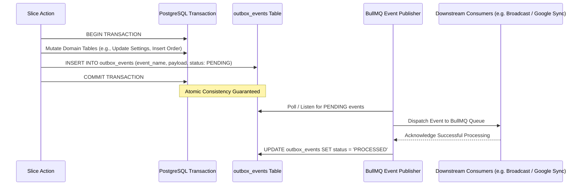

# Domain Events & Transactional Outbox Pattern

## 1. Reliable Event Publishing & The Outbox Pattern

To guarantee that database state mutations and downstream side effects (Telegram notifications, Google Cloud sync, BullMQ queue jobs) remain atomic and crash-safe, the platform implements the **Transactional Outbox Pattern**.



---

## 2. Outbox Schema Definition

```typescript
import { pgTable, uuid, text, jsonb, timestamp, integer } from 'drizzle-orm/pg-core';

export const outboxEvents = pgTable('outbox_events', {
  id: uuid('id').defaultRandom().primaryKey(),
  eventName: text('event_name').notNull(),
  aggregateId: text('aggregate_id').notNull(),
  payload: jsonb('payload').notNull(),
  status: text('status').$type<'PENDING' | 'PROCESSED' | 'FAILED'>().default('PENDING').notNull(),
  retryCount: integer('retry_count').default(0).notNull(),
  createdAt: timestamp('created_at', { withTimezone: true }).defaultNow().notNull(),
  processedAt: timestamp('processed_at', { withTimezone: true }),
});
```

---

## 3. Idempotent Consumer Invariants

Every background event consumer must be idempotent:
1. Every event carries a unique `id` (UUID).
2. The consumer verifies whether the event ID has already been processed before executing external API calls.
3. If already processed, the consumer acknowledges immediately without re-sending duplicate Telegram messages.
