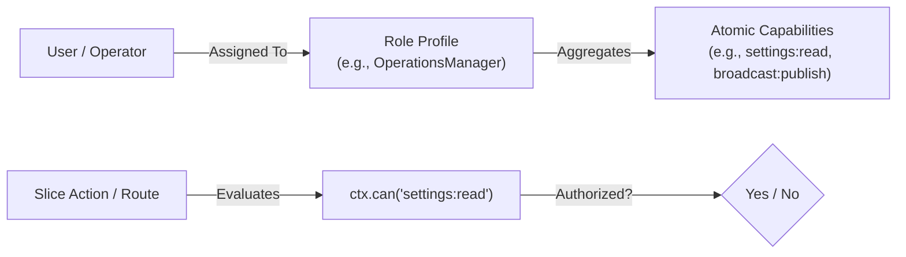

# Hybrid Role-Based Capability Architecture (RBCA)

## 1. Architectural Philosophy: Decoupling Code from Roles

In traditional applications, checking static roles directly in application code (`if (user.role === 'admin')`) leads to brittle systems:
- Introducing a new role requires auditing and modifying code across hundreds of files.
- Custom roles with partial permissions are impossible without major refactoring.

The **Tembot-v2 Platform** solves this by implementing a **Hybrid Role-Based Capability Architecture**:
1. **At the Code Layer (Zero-Role Engine):** Application logic and route handlers check fine-grained, atomic capabilities exclusively via `ctx.can(capability)` (e.g. `settings:write`, `orders:create`).
2. **At the Operator Layer (Dynamic Role Profiles):** Operators group capabilities into roles via the Web Admin Dashboard.



---

## 2. Standard Pre-Seeded Roles

The template ships with 4 standard pre-configured role profiles:

| Role Slug | Description | Default Assigned Capabilities |
| :--- | :--- | :--- |
| **`SuperAdmin`** | System Owner & Disaster Recovery | Wildcard (`*`) — All Kernel and Domain capabilities |
| **`OperationsManager`** | Business Operations & Campaigns | `settings:*`, `broadcast:*`, `tasks:*`, `media:*`, Domain (`*`) |
| **`Auditor`** | Compliance & Troubleshooting | `audit:read`, `audit:export`, `telemetry:read`, `settings:read` |
| **`EndUser`** | Telegram Bot & TMA Customer | `bot:interact`, `tma:access`, Domain User actions |

---

## 3. Dynamic Module Capability Auto-Discovery

When a developer adds a new domain module (e.g. `modules/domain/booking`):
1. The module manifest declares its exposed capabilities:
   ```typescript
   capabilities: ['booking:create', 'booking:cancel', 'booking:read'];
   ```
2. The Kernel Registry aggregates all capabilities during application boot.
3. The Web Admin Dashboard automatically renders new capability checkboxes in the Role Management UI, allowing operators to grant them dynamically without writing code.
