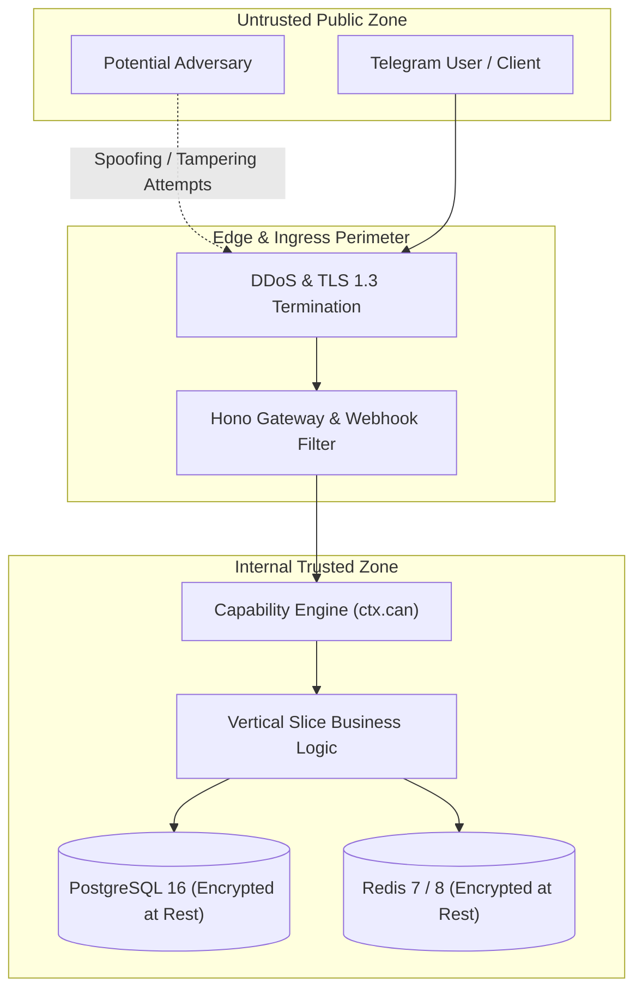

# Security Architecture: STRIDE Threat Model & Mitigations

> **Framework:** Microsoft STRIDE Threat Modeling Framework  
> **Target Scope:** Omnichannel Surfaces (Telegram Ingress, TMA, Hono Gateway, Data Stores)  
> **Security Baseline:** OWASP ASVS 5.0 Level 2

---

## 1. System Threat Landscape Topology

---

## 2. STRIDE Threat Analysis & Architectural Countermeasures

| Threat Category | Potential Attack Vector | Impact Level | Architectural Mitigation & Verification |
| :--- | :--- | :---: | :--- |
| **Spoofing (Identity)** | Forging Telegram `initData` or bot webhook updates to impersonate users | Critical | HMAC-SHA256 signature verification against secret bot token; secret webhook token header validation. |
| **Tampering (Data)** | Modifying ledger amounts or transaction references in-flight | Critical | Database-level triggers verifying double-entry debit/credit balance; immutable audit trail logging. |
| **Repudiation** | Operator denying having executed an administrative action | High | Append-only `audit_logs` table recording actor ID, IP address, before/after JSON diffs, and timestamp. |
| **Information Disclosure** | Leakage of customer PII, phone numbers, or tokens in application logs | High | Automatic in-flight redaction via logger; regional PII masking rules. |
| **Denial of Service** | Flooding Telegram webhooks or API endpoints with volumetric requests | High | In-memory token-bucket rate limiting middleware; Telegram auto-retry throttling; Cloudflare edge protection. |
| **Elevation of Privilege** | Standard user invoking admin ledger chart alteration endpoints | Critical | Zero-Role Capability Engine (`ctx.can`) checking permissions before vertical slice handler execution. |
