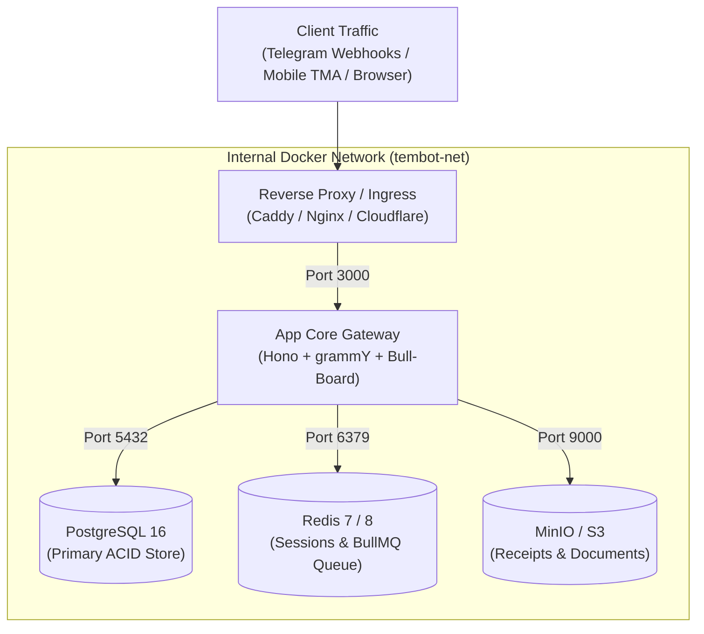

# Infrastructure Topology & Container Specifications

> **Target Environment:** Containerized Multi-Service Deployment (Docker Compose / Kubernetes)  
> **Base Runtime:** Node.js 24 Alpine  
> **Storage Layer:** PostgreSQL 16 + Redis 7/8 + S3-Compatible Object Storage (MinIO)

---

## 1. Local & Production Topology



---

## 2. Standard Service Port Bindings

| Service | Internal Port | Local Development Host Port | Production Binding |
| :--- | :---: | :---: | :--- |
| **`app`** (Hono & grammY) | `3000` | `3000` | Reverse proxy internal route only |
| **`postgres`** (Relational DB) | `5432` | `5432` | Strictly bound to internal docker bridge |
| **`redis`** (Cache & Queues) | `6379` | `6379` | Strictly bound to internal docker bridge |
| **`minio`** (S3 Storage) | `9000` | `9000` | Bound internally (CDN via Presigned URLs) |
| **`minio-console`** (S3 GUI) | `9001` | `9001` | Local development debugging only |

---

## 3. Reference `docker-compose.yml` Configuration

```yaml
version: '3.8'

services:
  postgres:
    image: postgres:16-alpine
    container_name: tembot-postgres
    restart: unless-stopped
    ports:
      - "5432:5432"
    environment:
      POSTGRES_USER: postgres
      POSTGRES_PASSWORD: postgrespassword
      POSTGRES_DB: tembot
    volumes:
      - postgres_data:/var/lib/postgresql/data
    healthcheck:
      test: ["CMD-SHELL", "pg_isready -U postgres -d tembot"]
      interval: 5s
      timeout: 5s
      retries: 5
    networks:
      - tembot-net

  redis:
    image: redis:7-alpine
    container_name: tembot-redis
    restart: unless-stopped
    ports:
      - "6379:6379"
    volumes:
      - redis_data:/data
    command: ["redis-server", "--appendonly", "yes"]
    healthcheck:
      test: ["CMD", "redis-cli", "ping"]
      interval: 5s
      timeout: 3s
      retries: 5
    networks:
      - tembot-net

  minio:
    image: minio/minio:RELEASE.2024-05-10T01-41-38Z
    container_name: tembot-minio
    restart: unless-stopped
    ports:
      - "9000:9000"
      - "9001:9001"
    environment:
      MINIO_ROOT_USER: minioadmin
      MINIO_ROOT_PASSWORD: miniopassword
    volumes:
      - minio_data:/data
    command: server /data --console-address ":9001"
    networks:
      - tembot-net

volumes:
  postgres_data:
  redis_data:
  minio_data:

networks:
  tembot-net:
    driver: bridge
```
