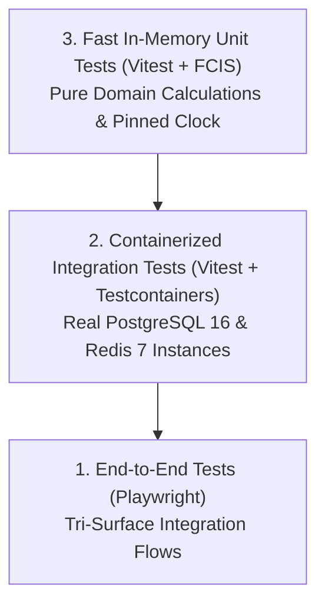

# Testing Handbook & Quality Assurance Standard

> **Framework:** Vitest 3.x + Testcontainers  
> **Testing Strategy:** Kent Beck Test-Driven Development (TDD)  
> **Mandatory Coverage:** $\ge 80\%$ Line & Branch Coverage

---

## 1. Testing Pyramid Architecture



---

## 2. In-Memory Unit Testing Invariants

- **Zero Network / Disk Dependencies:** Pure domain models execute in milliseconds without external daemons.
- **Deterministic Temporal Pinning:** Tests must never call `new Date()`. Time-sensitive assertions anchor to `PINNED_BASE_TIME`:
  ```typescript
  export const PINNED_BASE_TIME = new Date('2026-10-23T00:00:00.000Z');
  ```
- **Monadic Result Assertions:** Assert `result.isOk()` and `result.isErr()`. Do not wrap operations in try/catch.

---

## 3. Anti-Sham Verification Invariant

Writing tautological assertions like `expect(true).toBe(true)` or asserting mocks instead of real domain behavior is **strictly prohibited**. Every test must verify genuine business state transitions.
