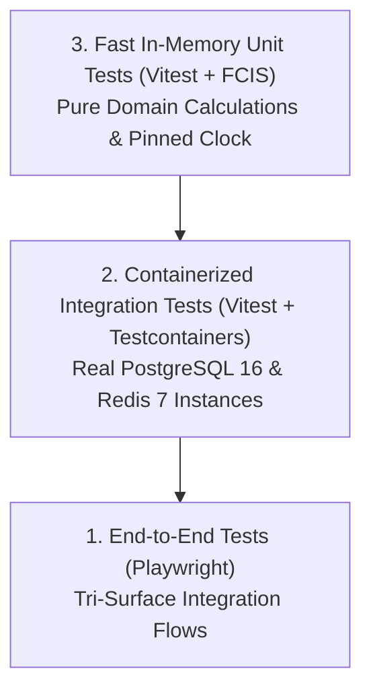

# Testing Handbook & Quality Assurance Standard

> **Framework:** Vitest 3.x + Testcontainers  
> **Testing Strategy:** Kent Beck Test-Driven Development (TDD)  
> **Mandatory Coverage:** $\ge 80\%$ Line & Branch Coverage

---

## 1. Testing Pyramid Architecture



---

## 2. In-Memory Unit Testing Invariants

- **Zero Network / Disk Dependencies:** Pure domain models execute in milliseconds without external daemons.
- **Deterministic Temporal Pinning:** Tests must never call `new Date()`. Time-sensitive assertions anchor to `PINNED_BASE_TIME`:
  ```typescript
  export const PINNED_BASE_TIME = new Date('2026-10-23T00:00:00.000Z');
  ```
- **Monadic Result Assertions:** Assert `result.isOk()` and `result.isErr()`. Do not wrap operations in try/catch.

---

## 4. Active Unit Test Suites Catalog

The test suite runs via Vitest (`pnpm test`) with zero network dependencies:

| Test Suite File | Tested Package / Module | Verifications Enforced |
| :--- | :--- | :--- |
| `packages/shared-types/test/errors.test.ts` | `@tembot/shared-types` | RFC 7807 ProblemDetails format, status codes, DomainError hierarchy. |
| `packages/kernel-registry/test/registry.test.ts` | `@tembot/kernel-registry` | Topological boot order calculation, DFS cyclic dependency detection. |
| `packages/slice-toolkit/test/action.test.ts` | `@tembot/slice-toolkit` | `defineAction` Zod fail-fast input validation, capability authorization. |
| `packages/logger/test/masking.test.ts` | `@tembot/logger` | PII redaction, token/key masking, sensitive paths protection. |
| `packages/ai-core/test/key-rotator.test.ts` | `@tembot/ai-core` | `ApiKeyRotator` rotation on HTTP 429, key pool exhaustion, cooldowns. |
| `packages/contracts/test/contracts.test.ts` | `@tembot/contracts` | Hex color validation, password length bounds, operator login DTO. |
| `packages/core-components/test/budgets.test.ts` | `@tembot/core-components` | Mobile button label ($\le 16$ chars), callback ($\le 36$B), rows ($\le 7$). |
| `modules/kernel/audit-log/test/hash-chain.test.ts` | `modules/kernel/audit-log` | SHA-256 hash chaining, genesis block, tamper evidence detection. |
| `modules/kernel/audit-log/test/error-recorder.test.ts` | `modules/kernel/audit-log` | `ErrorRecorder` serialization of DomainError & native Error types. |
| `modules/kernel/system-settings/test/settings-service.test.ts` | `modules/kernel/system-settings` | In-memory cache, tri-surface isolation, persistent keyboard, audit diff. |
| `modules/kernel/ai-gateway/test/ai-gateway.test.ts` | `modules/kernel/ai-gateway` | System One decision scoring, System Two generative fallbacks (Gemini -> DeepSeek). |

