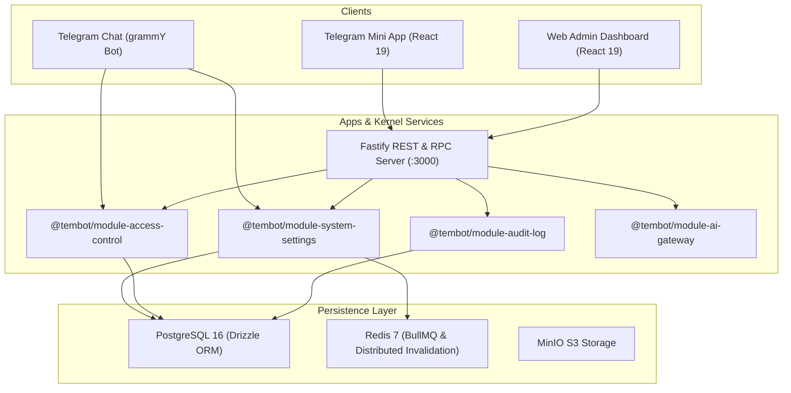

# 🏛️ Platform Tour & Architecture Overview

> Complete architectural walk-through of the Tembot Sovereign Omnichannel Starter Kit.

---

## 1. What is Tembot?

Tembot is an enterprise-grade, domain-agnostic template designed to launch resilient digital products across three synchronized surfaces:
1. **Telegram Bot (`apps/bot`):** conversational interface powered by `grammY`.
2. **Telegram Mini App (`apps/tma`):** full-screen web app embedded directly in Telegram via React 19 and Tailwind CSS v4.
3. **Web Admin Dashboard (`apps/dashboard`):** desktop-first operations cockpit for back-office operators and administrators.

All three surfaces are backed by a single central backend and shared TypeScript packages, ensuring zero schema drift, unified business logic, and cryptographic auditability.

---

## 2. The Three Sovereign Surfaces

### A. Telegram Bot (`apps/bot`)
* **Framework:** `grammY 1.46.0` with long-polling in development and webhook in production.
* **Navigation:** Dual-layer navigation:
  * Persistent Reply Keyboard at the bottom of the user's mobile screen (`📱 Mini App`, `⚙️ Settings`).
  * Rich Inline Keyboards attached to messages for interactive workflows.
* **Component Budget:** Strict compliance with mobile budgets via `@tembot/core-components` (max 32 chars button labels, 64-byte callbacks, max 7 rows).
* **Internationalization:** Automatic bidirectional switching between English (LTR) and Arabic (RTL) with zero hardcoded strings.

### B. Telegram Mini App (`apps/tma`)
* **Framework:** `React 19` + `Vite` + `Tailwind CSS v4`.
* **Telegram SDK:** `@telegram-apps/sdk-react` for native viewport control, theme synchronization, haptic feedback, and cryptographic `initData` delivery.
* **Tunneling Ready:** Pre-configured with `server.allowedHosts: true` for ngrok and custom domain forwarding.

### C. Web Admin Dashboard (`apps/dashboard`)
* **Framework:** `React 19` + `Vite` + `@tembot/ui`.
* **Role:** Dedicated back-office dashboard providing tenant overview, maintenance mode switches, branding customizations, and audit trails.

---

## 3. Shared Kernel Modules

| Kernel Module | Location | Mission |
| :--- | :--- | :--- |
| **System Settings** | `modules/kernel/system-settings` | Manages tenant configurations, surface states, default locales, and real-time distributed cache invalidation. |
| **Access Control** | `modules/kernel/access-control` | Cryptographic HMAC-SHA256 signature validation of Telegram `initData`, RBAC, and operator session tokens. |
| **Audit Log** | `modules/kernel/audit-log` | SHA-256 cryptographic hash-chained immutable audit log for regulatory compliance and forensic tracking. |
| **AI Gateway** | `modules/kernel/ai-gateway` | Dual-tier AI router with automatic failover between high-speed models (Gemini) and deep reasoning models (DeepSeek). |
